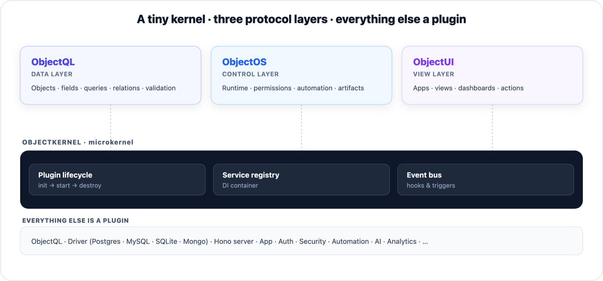

# ObjectStack

[](./LICENSE)

[](https://objectstack.ai/docs)

> ## The ontology is the software.
>
> **One executable business ontology.** AI writes it, the runtime runs it, agents
> operate it, you own it.
>
> 本体即软件。

`Executable` · `AI-writable` · `Agent-operable` · `You own it` · Apache-2.0

<p align="center">
  
  <br>
  <sub><b>1</b> · One definition, and the app runs &nbsp;·&nbsp; <b>2</b> · An agent creates a record over MCP &nbsp;·&nbsp; <b>3</b> · A read-only identity is refused</sub>
  <br>
  <a href="https://youtu.be/CX_FlOoOtr0"><b>▶&nbsp; Watch: ObjectStack in 90 Seconds</b></a>
  <br>
  <sub><a href="https://objectstack.ai/blog/the-ontology-is-the-software">Why it exists</a> &nbsp;·&nbsp; <a href="https://objectstack.ai/docs/concepts/compare">How it compares</a> &nbsp;·&nbsp; <a href="https://objectstack.ai/docs/concepts/when-to-use">When to use it</a></sub>
</p>

You build & ask with Claude Code or any coding agent: the agent writes the
metadata in your repo and operates the running app over MCP. To run it, this
repository ships ObjectOS Community — the `ghcr.io/objectstack-ai/objectstack`
image, `os start` and the Console, free and self-hosted ([Ship it](#ship-it)) —
while [ObjectOS](https://www.objectos.ai) Cloud is the hosted edition and ObjectOS
Enterprise the self-managed, licensed one.

## Try it in five minutes

No install at all? Open a live app on
[StackBlitz](https://stackblitz.com/github/objectstack-ai/hotcrm).

**1 · Create a project.** The scaffolder installs the AI skills bundle and writes
an `AGENTS.md`, so your agent starts with the protocol's rules already loaded —
not with generic "write me some TypeScript" priors.

```bash
npm create objectstack@latest my-app && cd my-app
```

**2 · Describe the requirement.** Open the project in Claude Code (or Cursor,
Copilot, …) and say what the business needs:

> Build a support desk. Add a `ticket` object with subject, description, a
> priority select and a status select. Add a **Resolve** action that only shows
> on tickets that aren't already resolved. Add an "Open tickets" list view and a
> Support nav group. Run `npm run validate` when you're done.

The agent writes typed metadata — not a codebase. The gate rejects what would
fail silently at runtime, and the agent fixes it before you ever see it.

**3 · Preview in the browser.**

```bash
npx os dev --ui   # → http://localhost:3000/_console/
```

The Console renders the real app — records, boards, dashboards. Something wrong?
Say what to change. **Requirement changes run the same loop**, on a diff you can
actually read.

<p align="center">
  
  
</p>
<p align="center"><sub>Prefer clicking? Studio authors the same metadata visually — same artifacts, same gate.</sub></p>

## What we mean by ontology

Your app's definition — objects and fields, relations, actions, permissions,
flows, and agent and tool definitions — is a **business ontology**: open,
versioned, and yours, not code scattered across a framework. It is executable,
not a knowledge-representation ontology (no inheritance, no axioms, no reasoner),
and it is not a semantic layer over your existing systems. The full account is
[Business Ontology](https://objectstack.ai/docs/concepts/ontology);
[How it compares](https://objectstack.ai/docs/concepts/compare) sets ObjectStack
beside knowledge ontologies, semantic layers, metadata platforms, and AI code
generation.

## The runtime runs it

Point an agent at an empty repo and you get a one-off codebase: every screen
hand-invented, every mistake yours to find at runtime. ObjectStack gives the
agent a **vocabulary** instead — typed, validated primitives for what enterprise
software is actually made of. The agent composes the definition; the runtime
already knows how to run it.

| | Capability |
| :--- | :--- |
| **Objects & fields** | Typed schemas with relations, validation, formulas, files |
| **Permissions** | RBAC plus row- and field-level security, enforced by the runtime |
| **Automation** | DAG flows, record triggers, scheduled jobs, webhooks |
| **Approvals** | Multi-step chains with queues and a full audit trail |
| **Views** | Lists, kanban, calendars, gantt, galleries — declared, not coded |
| **Dashboards & reports** | Charts, aggregations, KPIs bound to live data |
| **Actions** | Permission-checked buttons and server operations |
| **APIs & SDK** | Generated REST + realtime endpoints, typed client SDK |
| **AI tools** | Every object and exposed action doubles as a governed MCP tool |
| **Translations** | Labels and UI text as metadata, per locale |
| **Seed data** | Fixtures and demo datasets that ship with the app |
| **Datasources** | PostgreSQL, MySQL, SQLite, MongoDB, or in-memory |

Here's the shape of it — one object, and the database table, REST API, UI views,
and MCP tools all follow:

```ts
import { ObjectSchema, Field } from '@objectstack/spec/data';

export const Ticket = ObjectSchema.create({
  name: 'support_desk_ticket',
  label: 'Ticket',
  sharingModel: 'private',            // org-wide default — the security gate requires it
  fields: {
    subject: Field.text({ label: 'Subject', required: true, searchable: true }),
    status: Field.select({
      label: 'Status',
      required: true,
      options: [
        { label: 'Open', value: 'open', color: '#3B82F6', default: true },
        { label: 'Resolved', value: 'resolved', color: '#10B981' },
      ],
    }),
    due_date: Field.date({ label: 'Due Date' }),
  },
});
```

The REST API exists the moment the object does — no controllers to write — and
it runs under the same permissions as the UI.

## Agents are the first users

Objects are tools, actions are tools, permissions decide what an agent may call,
and audit records what it did. Because the app is typed metadata, the runtime
serves it as an **MCP server** at `/api/v1/mcp` — on by default. Point any MCP
client at it and an agent can inspect and *operate* the app you just built,
under the same permissions and RLS as a human:

```bash
claude mcp add --transport http my-app http://localhost:3000/api/v1/mcp
```

The first tool call opens a browser to sign you in — each deployment is its own
OAuth server, so there's no token to copy-paste. Headless setups (CI,
containers) use an API key instead. Objects are exposed automatically; actions
opt in with `ai: { exposed: true }`. See
[Connect an MCP Client](https://objectstack.ai/docs/ai/connect-mcp) for both flows.

## Why the mistakes don't ship

"AI writes it" is only useful if AI's mistakes don't reach production. Four gates
stand between the agent and your users:

| Gate | Catches |
| :--- | :--- |
| **Typed** | Strict TypeScript + Zod — shape errors die in the editor, seconds after the agent writes them |
| **Validated** | `os validate` rejects metadata that type-checks but would fail silently at runtime: dangling bindings, bad CEL predicates, missing security posture |
| **Reviewed** | You approve a small readable diff in the Console — not a pile of generated glue |
| **Governed** | The runtime enforces permissions and audit on every call, so even a wrong app stays inside the fence |

The reason this works is the same reason TypeScript was the right host language:
**an agent's errors become located, corrective text it can read and fix itself**,
in seconds — instead of a silent runtime failure nobody traces back.

The other half is size: apps small enough for AI to hold whole. The bundled example CRM — [`examples/app-crm`](./examples/app-crm):
objects, views, a dashboard, a lead-conversion flow, permission sets, actions,
translations — is small enough for an agent to load end-to-end, reason about
every dependency, and refactor across data, API, UI, and permissions in one
change. It can answer *"what breaks if I change this?"* instead of grepping and
hoping. The whole app is 1,873 lines of TypeScript (`examples/app-crm/src`,
tests excluded, at commit `95294be3`).

## You own it

**Everything needed to run an app is in this repository** — protocol,
microkernel, SDK, CLI, the production runtime and Console, permissions, audit,
and MCP. ObjectOS Cloud and Enterprise add hosting and multi-environment
operations, Build & Ask, SSO, and support.
This repository is Apache-2.0, except `ui/` (the Console and `@object-ui/*`), which is MIT — both permissive
([LICENSING.md](./LICENSING.md)). The definition lives in your repository as
ordinary TypeScript, versioned in your VCS and reviewable as a diff — not a
graph held inside a vendor's system.

> The ontology is the software. Your objects, relations, actions, permissions,
> flows, and agent and tool definitions are your business ontology — and the
> definition layer of the AI era should be an open protocol you own.
> [Read why](https://objectstack.ai/blog/the-ontology-is-the-software) · [the talk as a deck (PDF)](https://objectstack.ai/decks/the-ontology-is-the-software.pdf).

## Ship it

The scaffolded project is container-ready, on the official runtime image
[`ghcr.io/objectstack-ai/objectstack`](./docker):

```bash
docker build -t my-app . && docker compose up -d   # app + Postgres
```

See [Self-Hosted Deployment](https://objectstack.ai/docs/deployment/self-hosting)
for bare Node, Kubernetes, and the secrets you must pin — and
[Build with Claude Code](https://objectstack.ai/docs/getting-started/build-with-claude-code)
to run the whole loop end-to-end.

## Hack on the framework

```bash
git clone https://github.com/objectstack-ai/objectstack.git
cd objectstack
pnpm install          # Node 22+, pnpm 10 (corepack enable)
pnpm build            # build all packages
pnpm console:build    # put the Console SPA in packages/console/dist
pnpm dev              # showcase example: REST + Console on :3000
```

A first `pnpm build` takes about 7 minutes and the full `pnpm test` about 54
minutes on a 4-vCPU container; [`CONTRIBUTING.md`](./CONTRIBUTING.md#build-and-test-cost)
has the measured table and the `--affected` path for your own change.

Three layers sit on a microkernel — **ObjectQL** (data), **Kernel** (control),
**[ObjectUI](./ui)** (view). Everything starts as a Zod schema; TypeScript types, JSON
Schemas, REST routes, UI metadata, and agent tools are all derived from that one
source. The kernel provides only DI, the event bus, and lifecycle; every
capability — drivers, server, auth, security, automation, AI — is a plugin.

<p align="center">
  
</p>

Design details, the plugin lifecycle state machine, and the dependency graph are
in [ARCHITECTURE.md](./ARCHITECTURE.md).

### ObjectUI (`ui/`)

`ui/` is the view layer of ObjectStack: a schema-driven React renderer that turns a JSON
schema or ObjectStack metadata into production React UI, usable on its own through the
MIT-licensed `@object-ui/*` packages, and the source of the Console. Its components follow
Shadcn's DOM structure and Tailwind utilities, it talks to any backend through one
`DataSource` interface, heavy views (grid, kanban, calendar, gantt, dashboards, visual
designers) are lazy-loaded plugins, and every schema is a TypeScript type in
`@object-ui/types`, derived from `@objectstack/spec`. It builds on ideas from
[Amis](https://github.com/baidu/amis), [Formily](https://github.com/alibaba/formily),
[shadcn/ui](https://ui.shadcn.com/) and [Tailwind CSS](https://tailwindcss.com/).

<p align="center">
  
</p>

| You want to… | Start here | Install |
| :--- | :--- | :--- |
| Render a JSON schema inside your React app | [Quick Start](./ui/content/docs/guide/quick-start.md) | `npm install @object-ui/react @object-ui/components` |
| Build a UI from a JSON file, no React code at all | [`@object-ui/cli`](./ui/packages/cli) | `npm install -g @object-ui/cli` |

The guides are published at [objectui.org](https://www.objectui.org); working on `ui/` itself
is covered in [CONTRIBUTING.md](./CONTRIBUTING.md#ui-workspace-ui), and its packages are listed
in the [package directory](./CONTRIBUTING.md#package-directory).

### CLI

The CLI binary ships as both `os` and `objectstack`; `os --help` lists everything.

```bash
os init [name]    # Scaffold a new project
os create         # Interactive project / object scaffolder
os dev            # Dev server with hot-reload (REST + console)
os start          # Production server
os compile        # Build a deployable JSON environment artifact
os serve          # Serve a compiled artifact
os validate       # Validate metadata against the protocol
os lint           # Lint metadata for best-practice violations
os verify         # Boot the app in-process and verify it over real HTTP
os generate       # Scaffold objects, views, flows, agents, migrations
os diff           # Diff two metadata artifacts
os doctor         # Check environment health
os explain        # Explain protocol concepts on the command line
```

Cloud, package registry, secrets, and environment subcommands (`os package …`,
`os environments …`, `os login`, `os cloud …`) target an ObjectOS Cloud
control plane.

### Package directory

Every package in `packages/`, grouped by layer, plus the example apps, is in
[CONTRIBUTING.md](./CONTRIBUTING.md#package-directory).

## Community

- ⭐ **Star this repo** if ObjectStack is useful — it helps others find it.
- 🐛 Questions, bugs, or feature requests → [open an issue](https://github.com/objectstack-ai/objectstack/issues).
- 💬 Ideas and open-ended questions → [GitHub Discussions](https://github.com/objectstack-ai/objectstack/discussions).
- 🤝 Want to contribute? Start with [CONTRIBUTING.md](./CONTRIBUTING.md); [North Star](https://objectstack.ai/docs/concepts/north-star) says where the project is headed.
- 📖 Full documentation at [objectstack.ai/docs](https://objectstack.ai/docs); upgrading between majors is covered in the [upgrade guide](https://objectstack.ai/docs/upgrading).
- ☁️ Want it hosted, with Build & Ask AI built in? [ObjectOS](https://www.objectos.ai) Cloud runs these definitions for you — [objectstack-ai/objectos](https://github.com/objectstack-ai/objectos) is its public home.

## License

This repository is Apache-2.0, except `ui/` (the Console and `@object-ui/*`), which is MIT — both permissive.
See [LICENSE](./LICENSE), [ui/LICENSE](./ui/LICENSE) and [LICENSING.md](./LICENSING.md).
