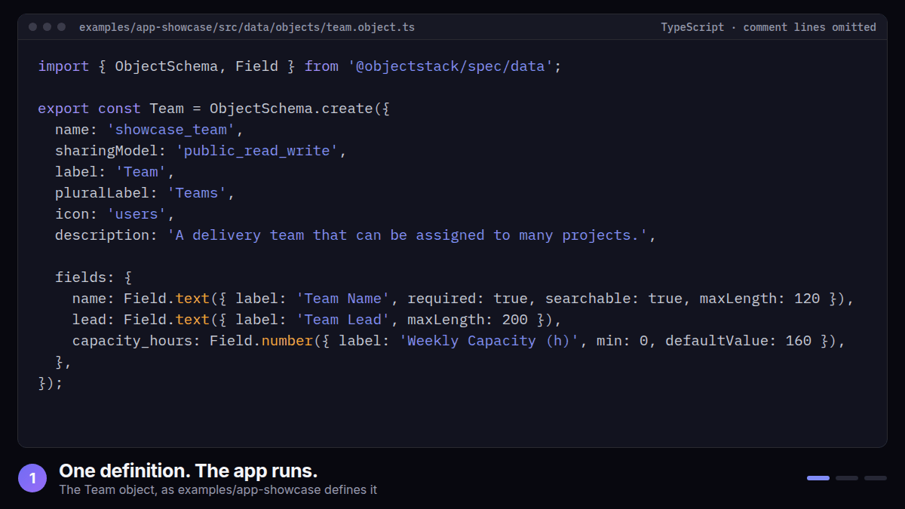
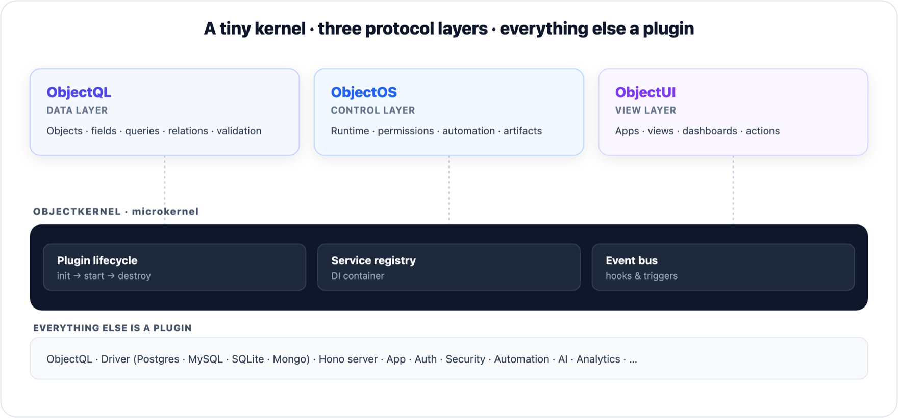
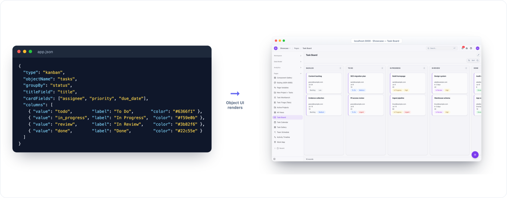

# ObjectStack

[English](./README.md) · **简体中文**

[](./LICENSE)

[](https://objectstack.ai/docs)

[官网](https://www.objectos.ai) · [文档](https://objectstack.ai/docs) · [Cloud](https://cloud.objectos.ai) · [讨论区](https://github.com/objectstack-ai/objectstack/discussions)

> ## 本体即软件。
>
> **一份可执行的业务本体。** AI 编写它，运行时运行它，Agent 操作它，你拥有它。
>
> The ontology is the software.

`可执行` · `AI 可编写` · `Agent 可操作` · `归你所有` · Apache-2.0

随仓库附带的参考 CRM（[`examples/app-crm`](./examples/app-crm)）共 30 个文件 / 2,189 行 TypeScript ≈ 22k token，可以整体装进 Agent 的上下文窗口。
<sub>自己数一遍：`find examples/app-crm/src -name '*.ts' -not -name '*.test.ts' | xargs cat | wc -l` · 提交 `e61af972`，不含测试，token 按约 4 字符/token 估算 · [完整计数](#为什么要写的更少)</sub>

<p align="center">
  
  <br>
  <sub><b>1</b> · 一份定义，应用就跑起来 &nbsp;·&nbsp; <b>2</b> · Agent 通过 MCP 创建一条记录 &nbsp;·&nbsp; <b>3</b> · 只读身份被拒绝</sub>
  <br>
  <a href="https://youtu.be/CX_FlOoOtr0"><b>▶&nbsp; 观看：90 秒了解 ObjectStack</b></a>
  <br>
  <sub><a href="https://objectstack.ai/blog/the-ontology-is-the-software">为什么有它</a> &nbsp;·&nbsp; <a href="https://objectstack.ai/docs/concepts/compare">与同类的比较</a> &nbsp;·&nbsp; <a href="https://objectstack.ai/docs/concepts/when-to-use">什么时候用它</a></sub>
</p>

你用 Claude Code 或任意编码 Agent 来 build & ask：Agent 在你的仓库里编写元数据，并通过 MCP
操作运行中的应用。为了运行它，本仓库提供 ObjectOS Community —— `ghcr.io/objectstack-ai/objectstack`
镜像、`os start` 和 Console，免费且自托管（[交付上线](#交付上线)）—— 而
[ObjectOS](https://www.objectos.ai) Cloud 是托管版本，ObjectOS 企业版是自管理、需许可的版本。

## 快速开始

所有入口都在这一张表里。[文档首页](https://objectstack.ai/docs)直接链接到这里，不另存一份。

| 我想…… | 运行 | 然后 |
| :--- | :--- | :--- |
| 让 Agent 搭一个新应用 | `npm create objectstack@latest my-app && cd my-app && npx os dev --ui` | 打开 `http://localhost:3000/_console/`。完整步骤见[五分钟上手](#五分钟上手)。 |
| 接入一个已在运行的数据库 | 在项目里声明它：`defineDatasource({ …, schemaMode: 'external' })`，再把对象绑定到它的表 | 这个数据库是联邦接入，不是复制：实时查询，绝不向它发送 DDL，默认只读——要写入，必须在数据源和对象上各自显式开启（[外部数据源](https://objectstack.ai/docs/data-modeling/external-datasources)）。 |
| 还没有项目，先把平台跑起来 | `npm i -g @objectstack/cli && os start` | 打开 `http://localhost:3000/_console/`。没有可加载的制品时，`os start` 启动一个空内核，你从 Console 的应用市场安装应用（[`os start`](https://objectstack.ai/docs/deployment/cli#os-start)）。 |
| 用官方镜像运行已编译的应用 | `docker run -p 8080:8080 -v "$PWD/dist/objectstack.json:/srv/app/objectstack.json:ro" -e OS_DATABASE_URL -e OS_AUTH_SECRET -e OS_SECRET_KEY ghcr.io/objectstack-ai/objectstack:latest` | 先导出这三个变量。`latest` 用来试用；生产环境请固定到确切的 `X.Y.Z` 标签（[镜像 README](./docker/README.md)）。 |
| 把脚手架生成的应用连同 Postgres 一起交付 | `docker build -t my-app . && docker compose up -d` | 在脚手架生成的项目里运行（[交付上线](#交付上线)）。 |
| 参与框架本身的开发 | `git clone https://github.com/objectstack-ai/objectstack.git` | 然后按[参与框架开发](#参与框架开发)操作。 |

## 五分钟上手

**1 · 创建项目。** 脚手架会安装 AI 技能包并写好一份 `AGENTS.md`，所以你的 Agent 一开始就带着协议的规则——
而不是带着泛泛的「给我写点 TypeScript」的先验。

```bash
npm create objectstack@latest my-app && cd my-app
```

**2 · 描述需求。** 在 Claude Code（或 Cursor、Copilot……）里打开项目，说出业务需要什么：

> 搭一个客服工单台。添加一个 `ticket` 对象，包含主题、描述、一个优先级单选字段和一个状态单选字段。
> 添加一个 **Resolve** 动作，只在尚未解决的工单上显示。添加一个「未关闭工单」列表视图和一个
> Support 导航分组。完成后运行 `npm run validate`。

Agent 写的是类型化的元数据——不是一个代码库。闸门会拒绝那些到运行时才悄悄失败的东西，
Agent 在你看到之前就把它修好了。

**3 · 在浏览器里预览。**

```bash
npx os dev --ui   # → http://localhost:3000/_console/
```

Console 渲染的是真实的应用——记录、看板、仪表盘。哪里不对？说出要改什么。
**需求变更走的是同一个循环**，改动落在一份你真能读完的 diff 上。

<p align="center">
  
  
</p>
<p align="center"><sub>更喜欢点鼠标？Studio 以可视化方式编写同一份元数据——同样的制品，同样的闸门。</sub></p>

## 为什么要写的更少

Agent 只写定义，不写定义之下的任何管道。同一类产品——CRM——的三种体量：

| | 文件数 | 行数 | ≈ Token |
| :--- | ---: | ---: | ---: |
| 传统手写的 CRM 代码库——典型的数量级，不是实测 | 数千 | 数十万 | 数百万 |
| [HotCRM](https://github.com/objectstack-ai/hotcrm) 销售模块——完整开源 CRM 中的销售部分：11 个对象、21 个流程文件、4 个仪表盘；不计语言包和种子数据 | 159 | 28,456 | ≈ 360k |
| 参考 CRM（[`examples/app-crm`](./examples/app-crm)）——6 个对象、视图、一个仪表盘、一个线索转化流程、权限集、动作、翻译 | 30 | 2,189 | ≈ 22k |

```bash
# 在本仓库里：参考 CRM
find examples/app-crm/src -name '*.ts' -not -name '*.test.ts' | wc -l               # 30 个文件
find examples/app-crm/src -name '*.ts' -not -name '*.test.ts' | xargs cat | wc -l   # 2,189 行
find examples/app-crm/src -name '*.ts' -not -name '*.test.ts' | xargs cat | wc -c   # 87,005 字节 ≈ 22k token

# 在 objectstack-ai/hotcrm 的克隆里：销售模块，不含语言包和种子数据
find src/sales -name '*.ts' -not -name '*.test.ts' -not -path '*/translations/*' -not -path '*/data/*' | wc -l               # 159 个文件
find src/sales -name '*.ts' -not -name '*.test.ts' -not -path '*/translations/*' -not -path '*/data/*' | xargs cat | wc -l   # 28,456 行
find src/sales -name '*.ts' -not -name '*.test.ts' -not -path '*/translations/*' -not -path '*/data/*' | xargs cat | wc -c   # 1,446,608 字节 ≈ 360k token
```

两行实测数据统计的都是非测试 `.ts` 文件，token 按约 4 字符/token 估算（`wc -c` ÷ 4）：本仓库取自提交
`e61af972`，HotCRM 取自它的提交 `94f8d04`。HotCRM 这一行只统计它的销售模块（`src/sales`），
不含 `src/sales/translations` 里的语言包和 `src/sales/data` 里的种子数据——算上它们，这个模块是
204 个文件 / 40,868 行——也不统计 HotCRM 的其他模块：服务、营销、营收、订单到回款、费用和项目交付。
参考 CRM 的计数包含它的翻译和种子数据。两者都在持续变化，要看今天的数字请自己运行这些命令。
参考 CRM 约占 200k token 上下文窗口的 11%；HotCRM 销售模块比这个窗口大，能装进 1M token 的窗口。

决策——对象、关系、权限、流程——留在本体里，因为只有你能做这些决定。管道——数据表、CRUD API、
列表页和详情页、权限检查、审计写入——由运行时派生，所以没有人去写它。这里说的是体量，不是速度：
目前还没有公开、可复现的构建耗时基准，所以本 README 不给出任何倍数。
[《一个业务应用到底有多少 token？》](https://www.objectos.ai/zh-Hans/blog/business-app-in-16k-tokens/)
完整展开了这个论证；文中的数字测于更早的提交，与上面的不同。

## 我们说的本体是什么

你的应用的定义——对象与字段、关系、动作、权限、流程，以及 Agent 和工具的定义——就是一份**业务本体**：
开放、有版本、归你所有，而不是散落在某个框架里的代码。它是可执行的，不是知识表示意义上的本体
（没有继承，没有公理，没有推理机），也不是架在你现有系统之上的语义层：语义层描述的是一个在别处运行的业务，
而这份定义本身就是运行的东西。已在运行的系统仍然可以作为
[外部数据源](https://objectstack.ai/docs/data-modeling/external-datasources)接入本体：
它们的表成为本体里的对象，默认只读，要写入必须在数据源和对象上各自显式开启。联邦能力尚在早期。
完整的说明见 [Business Ontology](https://objectstack.ai/docs/concepts/ontology)；
[How it compares](https://objectstack.ai/docs/concepts/compare) 把 ObjectStack 与知识本体、语义层、
元数据平台和 AI 代码生成放在一起比较。

## 运行时运行它

把一个 Agent 指向一个空仓库，你得到的是一份一次性的代码库：每个页面都是现编的，每个错误都要你自己到运行时去找。
ObjectStack 给 Agent 的是一套**词汇**——针对企业软件真正的构成要素的、类型化且经过校验的原语。
Agent 组合出定义；运行时本来就知道怎么运行它。

| | 能力 |
| :--- | :--- |
| **对象与字段** | 类型化的 schema，带关系、校验、公式、文件 |
| **权限** | RBAC 加行级和字段级安全，由运行时强制执行 |
| **自动化** | DAG 流程、记录触发器、定时任务、webhook |
| **审批** | 多级审批链，带队列和完整的审计轨迹 |
| **视图** | 列表、看板、日历、甘特图、画廊——声明出来，不用写代码 |
| **仪表盘与报表** | 图表、聚合、绑定实时数据的 KPI |
| **动作** | 经过权限检查的按钮和服务端操作 |
| **API 与 SDK** | 自动生成的 REST 与实时端点，类型化的客户端 SDK |
| **AI 工具** | 每个对象和每个对外暴露的动作同时也是一个受治理的 MCP 工具 |
| **翻译** | 标签和界面文本作为元数据，按语言区域提供 |
| **种子数据** | 随应用一起交付的初始数据和演示数据集 |
| **数据源** | PostgreSQL、MySQL、SQLite、MongoDB 或内存 |

它大致是这个样子——一个对象，数据库表、REST API、界面视图和 MCP 工具都随之而来：

```ts
import { ObjectSchema, Field } from '@objectstack/spec/data';

export const Ticket = ObjectSchema.create({
  name: 'support_desk_ticket',
  label: 'Ticket',
  sharingModel: 'private',            // 组织范围的默认值——安全闸门要求必须声明
  fields: {
    subject: Field.text({ label: 'Subject', required: true, searchable: true }),
    status: Field.select({
      label: 'Status',
      required: true,
      options: [
        { label: 'Open', value: 'open', color: '#3B82F6', default: true },
        { label: 'Resolved', value: 'resolved', color: '#10B981' },
      ],
    }),
    due_date: Field.date({ label: 'Due Date' }),
  },
});
```

对象存在的那一刻，REST API 就存在了——不用写控制器——而且它和界面运行在同一套权限之下。

## Agent 是第一批用户

对象是工具，动作是工具，权限决定 Agent 可以调用什么，审计记录它做了什么。因为应用是类型化的元数据，
运行时把它作为一个 **MCP 服务器**提供在 `/api/v1/mcp`——默认开启。把任意 MCP 客户端指向它，
Agent 就能查看并*操作*你刚搭好的应用，受到的权限和 RLS 约束与人一样：

```bash
claude mcp add --transport http my-app http://localhost:3000/api/v1/mcp
```

第一次工具调用会打开浏览器让你登录——每个部署都是它自己的 OAuth 服务器，所以没有 token 要复制粘贴。
无界面的环境（CI、容器）改用 API key。对象自动暴露；动作通过 `ai: { exposed: true }` 选择加入。
两种流程都见 [Connect an MCP Client](https://objectstack.ai/docs/ai/connect-mcp)。

## 为什么错误到不了生产

「AI 来写」只有在 AI 的错误到不了生产时才有用。Agent 和你的用户之间隔着四道闸门：

| 闸门 | 拦住什么 |
| :--- | :--- |
| **类型化** | 严格的 TypeScript + Zod——形状错误在编辑器里就消失，Agent 写下它几秒之后 |
| **校验** | `os validate` 拒绝那些通过了类型检查、却会在运行时悄悄失败的元数据：悬空的绑定、错误的 CEL 谓词、缺失的安全姿态 |
| **审阅** | 你在 Console 里批准的是一份小而可读的 diff——不是一堆生成出来的胶水代码 |
| **治理** | 运行时在每次调用上强制执行权限和审计，所以即使应用写错了，也出不了围栏 |

这套办法管用的原因，和 TypeScript 是合适的宿主语言的原因是同一个：
**Agent 的错误变成了有定位、可纠正的文本，它自己读得懂、改得了**，几秒之内——
而不是一次没人能追溯回来的运行时静默失败。

另一半是体量：应用小到 AI 能整体装下。随仓库附带的示例 CRM——[`examples/app-crm`](./examples/app-crm)：
对象、视图、一个仪表盘、一个线索转化流程、权限集、动作、翻译——小到 Agent 可以从头到尾加载它，
推理每一处依赖，并在一次变更里跨数据、API、界面和权限完成重构。它能回答*「我改这里会弄坏什么？」*，
而不是 grep 一通然后听天由命。整个应用是 30 个文件、2,189 行 TypeScript，约 22k token
（`examples/app-crm/src`，不含测试，提交 `e61af972`；[自己数一遍](#为什么要写的更少)）。

## 你拥有它

**运行一个应用所需的一切都在这个仓库里**——协议、微内核、SDK、CLI、生产运行时和 Console、权限、审计和 MCP——
单点登录（OIDC / SAML）也包含在内，免费。这就是 ObjectOS Community，三个版本中的一个：

| 版本 | 如何获得 | 增加了什么 |
| :--- | :--- | :--- |
| **ObjectOS Community** | 本仓库——自托管，免费，Apache-2.0 | 基线：上面列出的一切。AI 通过 MCP 接入应用，用你自己的 Agent 和模型 |
| **ObjectOS Cloud** | 由我们托管 | 产品内的 Build & Ask |
| **ObjectOS 企业版** | 在你自己的基础设施上自管理，需许可 | 产品内 AI、AI 治理、按组织层级的记录可见性、针对密钥类数据的客户自管密钥、支持服务 |

逐行对照的矩阵见[版本对比](https://docs.objectos.ai/docs/editions/compare)。

本仓库采用 Apache-2.0 许可，`ui/`（Console 和 `@object-ui/*`）除外，它采用 MIT——两者都是宽松许可
（[LICENSING.md](./LICENSING.md)）。定义以普通 TypeScript 的形式放在你的仓库里，由你的版本控制系统管理版本，
可以作为 diff 审阅——而不是一张存在厂商系统里的图。

> 本体即软件。你的对象、关系、动作、权限、流程，以及 Agent 和工具的定义，就是你的业务本体——
> 而 AI 时代的定义层，应该是一个归你所有的开放协议。
> [了解原因](https://objectstack.ai/blog/the-ontology-is-the-software) · [演讲的幻灯片（PDF）](https://objectstack.ai/decks/the-ontology-is-the-software.pdf)。

## 交付上线

脚手架生成的项目开箱即可容器化，基于官方运行时镜像
[`ghcr.io/objectstack-ai/objectstack`](./docker)：

```bash
docker build -t my-app . && docker compose up -d   # 应用 + Postgres
```

裸 Node、Kubernetes 以及必须固定的密钥，见
[Self-Hosted Deployment](https://objectstack.ai/docs/deployment/self-hosting)；
把整个循环端到端跑一遍，见
[Build with Claude Code](https://objectstack.ai/docs/getting-started/build-with-claude-code)。

## 参与框架开发

```bash
git clone https://github.com/objectstack-ai/objectstack.git
cd objectstack
pnpm install          # Node 22+，pnpm 10（corepack enable）
pnpm build            # 构建所有包
pnpm console:build    # 把 Console SPA 放进 packages/console/dist
pnpm dev              # showcase 示例：REST + Console，端口 :3000
```

在 4 vCPU 的容器上，首次 `pnpm build` 大约需要 7 分钟，完整的 `pnpm test` 大约需要 54 分钟；
[`CONTRIBUTING.md`](./CONTRIBUTING.md#build-and-test-cost) 里有实测的表格，以及只针对你自己改动的 `--affected` 路径。

三层架构坐落在一个微内核之上——**ObjectQL**（数据）、**Kernel**（控制）、
**[ObjectUI](./ui)**（视图）。一切都从 Zod schema 开始；TypeScript 类型、JSON Schema、REST 路由、
界面元数据和 Agent 工具全部从这一个源头派生。内核只提供 DI、事件总线和生命周期；每一项能力——
驱动、服务器、认证、安全、自动化、AI——都是插件。

<p align="center">
  
</p>

设计细节、插件生命周期状态机和依赖图见 [ARCHITECTURE.md](./ARCHITECTURE.md)。

### ObjectUI（`ui/`）

`ui/` 是 ObjectStack 的视图层：一个 schema 驱动的 React 渲染器，把 JSON schema 或 ObjectStack
元数据变成可用于生产的 React 界面；它可以通过 MIT 许可的 `@object-ui/*` 包独立使用，也是 Console 的源码所在。
它的组件遵循 Shadcn 的 DOM 结构和 Tailwind 工具类，通过一个 `DataSource` 接口对接任意后端，
重型视图（表格、看板、日历、甘特图、仪表盘、可视化设计器）是懒加载的插件，每个 schema 都是
`@object-ui/types` 里的一个 TypeScript 类型，派生自 `@objectstack/spec`。它借鉴了
[Amis](https://github.com/baidu/amis)、[Formily](https://github.com/alibaba/formily)、
[shadcn/ui](https://ui.shadcn.com/) 和 [Tailwind CSS](https://tailwindcss.com/) 的思路。

<p align="center">
  
</p>

| 你想…… | 从这里开始 | 安装 |
| :--- | :--- | :--- |
| 在你的 React 应用里渲染一份 JSON schema | [Quick Start](https://objectstack.ai/docs/frontend/quick-start) | `npm install @object-ui/react @object-ui/components` |
| 只用一个 JSON 文件搭界面，完全不写 React 代码 | [`@object-ui/cli`](./ui/packages/cli) | `npm install -g @object-ui/cli` |

这些指南发布在文档站的 [Custom front-end](https://objectstack.ai/docs/frontend) 下；参与 `ui/` 本身的开发见
[CONTRIBUTING.md](./CONTRIBUTING.md#ui-workspace-ui)，它的包列在
[包目录](./CONTRIBUTING.md#package-directory)里。

### CLI

CLI 的可执行文件同时以 `os` 和 `objectstack` 两个名字提供；`os --help` 列出全部命令。

```bash
os init [name]    # 用脚手架创建新项目
os create         # 交互式的项目 / 对象脚手架
os dev            # 带热重载的开发服务器（REST + console）
os start          # 生产服务器
os compile        # 构建可部署的 JSON 环境制品
os serve          # 运行一个已编译的制品
os validate       # 按协议校验元数据
os lint           # 检查元数据是否违反最佳实践
os verify         # 在进程内启动应用，并通过真实 HTTP 验证它
os generate       # 生成对象、视图、流程、Agent、迁移的脚手架
os diff           # 比较两份元数据制品
os doctor         # 检查环境是否健康
os explain        # 在命令行里解释协议概念
```

Cloud、包注册表、密钥和环境相关的子命令（`os package …`、`os environments …`、`os login`、
`os cloud …`）面向的是 ObjectOS Cloud 的控制面。

### 包目录

`packages/` 下的每个包（按层分组）以及示例应用，都列在
[CONTRIBUTING.md](./CONTRIBUTING.md#package-directory) 里。

## 社区

- ⭐ 如果 ObjectStack 对你有用，请**给这个仓库点个 Star**——这能帮助其他人找到它。
- 🐛 提问、报告缺陷或提出功能需求 → [提交 issue](https://github.com/objectstack-ai/objectstack/issues)。
- 💬 想法和开放式的问题 → [GitHub Discussions](https://github.com/objectstack-ai/objectstack/discussions)。
- 🤝 想参与贡献？从 [CONTRIBUTING.md](./CONTRIBUTING.md) 开始；[North Star](./docs/NORTH-STAR.md) 说明了项目的方向。
- 📖 完整文档在 [objectstack.ai/docs](https://objectstack.ai/docs)；跨大版本升级见[升级指南](https://objectstack.ai/docs/upgrading)。
- ☁️ 想要托管版本，并且内置 Build & Ask AI？[ObjectOS](https://www.objectos.ai) Cloud 替你运行这些定义——[objectstack-ai/objectos](https://github.com/objectstack-ai/objectos) 是它的公开主页。

## 许可证

本仓库采用 Apache-2.0 许可，`ui/`（Console 和 `@object-ui/*`）除外，它采用 MIT——两者都是宽松许可。
见 [LICENSE](./LICENSE)、[ui/LICENSE](./ui/LICENSE) 和 [LICENSING.md](./LICENSING.md)。
