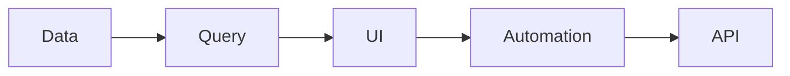

ObjectStack ships a set of **domain-specific skills** that teach AI assistants (Claude Code, GitHub Copilot, Cursor, …) the protocol's schemas, patterns, and constraints — plus **process** skills that teach how work moves through a project rather than what to author. This guide is the complete catalog.

<Callout type="info">
**New to skills?** Read [AI Skills System](/docs/ai/skills) first for the conceptual overview, then return here for the per-skill reference.
</Callout>

---

## Installing skills

The catalog ships as the npm package [`@objectstack/skills`](https://www.npmjs.com/package/@objectstack/skills), released together with every other `@objectstack/*` package at one shared version. Install it at the version of the `@objectstack/spec` your project has installed — the catalog's version is then your spec's, so the skills teach what that spec accepts — and copy it from `node_modules` into your coding agent's skills directory:

```bash
# 1 · the catalog, at the version of your installed @objectstack/spec
pnpm add -D "@objectstack/skills@$(node -p "require('@objectstack/spec/package.json').version")"
#   npm: npm install --save-dev "@objectstack/skills@…"   ·   yarn: yarn add -D "@objectstack/skills@…"

# 2 · copy it from node_modules into your agent's skills directory
npx skills@1.7.2 experimental_sync --agent claude-code --copy -y
```

Add the package with the manager that installed the project: in a pnpm project, `npm install --save-dev` exits `1` with `npm error Cannot read properties of null (reading 'edgesOut')`.

Step 2 is the [skills CLI](https://www.npmjs.com/package/skills)'s sync from `node_modules`: it finds the skills under `node_modules/@objectstack/skills/dist/skills/`, copies each one into your agent's directory — for `claude-code`, real files in `.claude/skills/<skill>` and nowhere else — and records the source and version in `skills-lock.json`. Commit both with the project. Keep `--copy`: without it the sync writes links into `node_modules`, which is not committed, so a clone of the project gets dangling links and no skills. The CLI is pinned because `experimental_sync` is that tool's own unstable interface; `create-objectstack` runs the same version. Name your own runtime after `--agent` (`codex`, `cursor`, …), one runtime per run — never `--agent '*'`, which copies the catalog into dozens of agent directories at once. A bare `npm install --save-dev @objectstack/skills` installs whichever version the registry tags `latest`, not your spec's — keep the version in step 1.

**Updating.** The catalog is versioned as **one bundle**, and it moves only with your ObjectStack version — you never track or update a skill on its own: bump `@objectstack/skills` with the other `@objectstack/*` packages, then re-run the sync (step 2, same flags) and commit what it changed.

**Which versions exist.** `@objectstack/skills` is published from `18.0.0-next.0` on; there is no 17.x release of it. A project on `@objectstack/spec` 17.x therefore has no catalog bound to its version: step 1 refuses with `ERR_PNPM_NO_MATCHING_VERSION` (npm: `ETARGET`; both print `No matching version found`), and moving it to 18 includes [a skills step](/docs/upgrading#moving-the-dependency-pins). One scaffolder is the exception to the next paragraph: `create-objectstack@18.0.0-next.0` still installed the skills from the repository's `main` with `skills add`, and step 2 skips every skill a `skills add` installed (it prints `Skipped … installed with skills add` and exits 0), so in a project it scaffolded run `npx skills list` first, because `npx skills remove --all` removes every installed skill without asking; run that when the list shows only the `objectstack-*` skills — or remove those by name, as the [upgrade step](/docs/upgrading#moving-the-dependency-pins) does, if you added others — and then steps 1 and 2.

**New projects.** `create-objectstack` runs both steps while it scaffolds: the `package.json` it writes depends on `@objectstack/skills` at the same version as `@objectstack/spec`, its dependency install puts the catalog in `node_modules`, and step 2 copies it for one agent runtime, into `.claude/skills/`. Its closing summary prints step 2 again — to re-run after an upgrade, and with another `--agent` for any other runtime you use.

```bash
npm create objectstack@latest my-app
```

**The `next` channel.** `npx skills add objectstack-ai/objectstack/skills --skill '*' --agent claude-code -y` reads the catalog straight from the repository's unreleased `main` — for trying the next version's skills, not for a released project.

---

{/* BEGIN GENERATED: skills (packages/spec/scripts/build-skill-docs.ts) — DO NOT EDIT */}

ObjectStack ships **10 skills** — one per authoring domain, plus process skills for how a project is delivered. Each is self-contained: an AI assistant loads only the ones a task needs.

## Quick Reference

| # | Skill | Domain | Path | What it covers |
| :--- | :--- | :--- | :--- | :--- |
| 1 | [Platform](#platform) | `platform` | `skills/objectstack-platform/` | Bootstrap, configure, extend, and operate ObjectStack runtimes. Covers project setup (`defineStack`, drivers, scaffolding), declaring platform capabilities (`requires:` — which service plugins boot), plugin and service development (PluginContext, DI, kernel hooks like `kernel:ready`), and operations (CLI commands, migrations, deployment, test harnesses via LiteKernel). |
| 2 | [Data](#data) | `data` | `skills/objectstack-data/` | Design ObjectStack data schemas — objects, fields, relationships, validations, indexes, hooks, security, seeds and datasources. |
| 3 | [Query](#query) | `query` | `skills/objectstack-query/` | Construct ObjectQL queries — filters, sorting, pagination, aggregation, relation expansion, and full-text search. |
| 4 | [UI](#ui) | `ui` | `skills/objectstack-ui/` | Author ObjectStack UI metadata — Views (list/form/kanban/calendar/gantt), Apps (navigation), Pages (structured plus the HTML and React source-authoring tiers, ADR-0080/0081), Dashboards, Reports, Charts, Actions, and package Docs (`src/docs/*.md`). |
| 5 | [Automation](#automation) | `automation` | `skills/objectstack-automation/` | Design ObjectStack automation — Flows (visual logic), Triggers, Approvals, state machines, and the `jobs` (`defineJob`) / `webhooks` (`defineWebhook`) stack collections. |
| 6 | [AI](#ai) | `ai` | `skills/objectstack-ai/` | Design ObjectStack AI skills, tools, knowledge sources, and the open-edition MCP server surface. |
| 7 | [API](#api) | `api` | `skills/objectstack-api/` | Design the server-side API surface that an ObjectStack runtime exposes — REST endpoints, auth providers, realtime channels, error envelopes, batch contracts. |
| 8 | [i18n](#i18n) | `i18n` | `skills/objectstack-i18n/` | Author ObjectStack translation bundles — object/field labels, view text, app navigation strings, automation messages — and configure locale fallback, coverage reporting, and the source layout. |
| 9 | [Formula](#formula) | `expression` | `skills/objectstack-formula/` | Author CEL expressions used across ObjectStack — formula fields, field conditional rules (`visibleWhen`, `readonlyWhen`, `requiredWhen`), validation / sharing / visibility predicates, flow conditions, and dynamic seed values. This is the companion skill that objectstack-data, -ui, -api and -automation each tell you to load alongside them. |
| 10 | [Upgrade](#upgrade) | `process` | `skills/objectstack-upgrade/` | Upgrade an ObjectStack metadata project across a protocol major — run the deterministic conversion chain, then work the semantic residue the chain cannot express (intent choices, custom code on retired APIs, stale prose) to a decision with the project's owner, and finish with a green `validate` plus a human-readable upgrade report. |

---

### Platform

**Domain** `platform` · **Path** `skills/objectstack-platform/`

Bootstrap, configure, extend, and operate ObjectStack runtimes. Covers project setup (`defineStack`, drivers, scaffolding), declaring platform capabilities (`requires:` — which service plugins boot), plugin and service development (PluginContext, DI, kernel hooks like `kernel:ready`), and operations (CLI commands, migrations, deployment, test harnesses via LiteKernel).

Use when the user is writing `objectstack.config.ts`, building a plugin or driver, turning a platform capability on, mounting the Hono HTTP layer, running `os` CLI commands, or planning deployment.

Do not use for data schema design (see objectstack-data) or query patterns (see objectstack-query); data lifecycle hooks (beforeInsert / afterUpdate) belong in objectstack-data — only kernel / service-level events live here.

**Tags:** `project`, `defineStack`, `driver`, `hono`, `plugin`, `kernel`, `service`, `requires`, `capability`, `DI`, `lifecycle`, `cli`, `deploy`, `ops`

---

### Data

**Domain** `data` · **Path** `skills/objectstack-data/`

Design ObjectStack data schemas — objects, fields, relationships, validations, indexes, hooks, security, seeds and datasources.

Use when the user is creating or modifying `*.object.ts` files or `src/data/*.ts` seed modules, picking field types, modelling relationships, writing `beforeInsert`/`afterUpdate` hooks, configuring per-object access control, pointing an object at an existing external database, or authoring bootstrap / demo data. Use for `visibleWhen` / `readonlyWhen` / `requiredWhen` rules that belong on fields.

Do not use for querying data (see objectstack-query) or for plugin / kernel hooks (see objectstack-platform). CEL expressions: load objectstack-formula alongside.

**Tags:** `object`, `field`, `validation`, `index`, `relationship`, `hook`, `schema`, `permission`, `rls`, `security`, `seed`, `fixture`

---

### Query

**Domain** `query` · **Path** `skills/objectstack-query/`

Construct ObjectQL queries — filters, sorting, pagination, aggregation, relation expansion, and full-text search.

Use when the user is writing a query DSL expression or picking a pagination strategy.

Do not use for defining objects / fields / relationships (see objectstack-data), for designing the API endpoint that exposes a query (see objectstack-api), or for a list view's filter rules / dashboard datasets (see objectstack-ui).

**Tags:** `query`, `filter`, `sort`, `paginate`, `aggregate`, `ObjectQL`, `full-text`

---

### UI

**Domain** `ui` · **Path** `skills/objectstack-ui/`

Author ObjectStack UI metadata — Views (list/form/kanban/calendar/gantt), Apps (navigation), Pages (structured plus the HTML and React source-authoring tiers, ADR-0080/0081), Dashboards, Reports, Charts, Actions, and package Docs (`src/docs/*.md`).

Use when the user is adding `*.view.ts` / `*.page.ts` / `*.app.ts` / `*.dashboard.ts` / `*.report.ts` / `*.dataset.ts` / `*.action.ts` / `src/docs/*.md` files or designing a Studio-rendered UI surface.

Do not use for: data schema (see objectstack-data), multi-step flows that BRANCH on logic between steps (those are `*.flow.ts` with `type: 'screen'` — see objectstack-automation; a stepped form over ONE object is this skill's `formViews` `type: 'wizard'`), or Studio's own admin UI (that ships with the platform). CEL expressions in visibility/conditional rules: load objectstack-formula alongside.

**Tags:** `view`, `app`, `page`, `dashboard`, `report`, `chart`, `action`, `widget`, `doc`

---

### Automation

**Domain** `automation` · **Path** `skills/objectstack-automation/`

Design ObjectStack automation — Flows (visual logic), Triggers, Approvals, state machines, and the `jobs` (`defineJob`) / `webhooks` (`defineWebhook`) stack collections.

Use when the user is adding `*.flow.ts`, wiring an event-driven rule, modelling an approval chain, or building an interactive screen flow / wizard (objectstack-ui routes those here).

Do not use for data lifecycle hooks at the object layer (see objectstack-data) or for kernel / plugin events (see objectstack-platform). CEL expressions in flow conditions / edge guards: load objectstack-formula alongside.

**Tags:** `flow`, `workflow`, `trigger`, `approval`, `state-machine`, `scheduled`, `webhook`

---

### AI

**Domain** `ai` · **Path** `skills/objectstack-ai/`

Design ObjectStack AI skills, tools, knowledge sources, and the open-edition MCP server surface.

Use when the user is adding `*.skill.ts` / `*.tool.ts`, configuring an LLM provider, wiring the tools a skill grants, or indexing ObjectStack data as a knowledge source for RAG. Agents themselves are platform-internal (`ask` / `build`) — third parties extend them via skills, not by authoring `*.agent.ts`.

Do not use for general LLM prompting questions unrelated to ObjectStack metadata.

**Tags:** `agent`, `tool`, `skill`, `knowledge`, `llm`, `embedding`, `mcp`

---

### API

**Domain** `api` · **Path** `skills/objectstack-api/`

Design the server-side API surface that an ObjectStack runtime exposes — REST endpoints, auth providers, realtime channels, error envelopes, batch contracts.

Use when the user is adding `*.endpoint.ts`, configuring auth providers, defining custom routes, or extending the REST generator.

Do not use for: consuming an ObjectStack API from a client (that is just standard HTTP — no skill needed); the auto-generated CRUD endpoints (those follow from objectstack-data); request-side query syntax (see objectstack-query). CEL expressions in route guards or auth predicates: load objectstack-formula alongside.

**Tags:** `rest`, `endpoint`, `auth`, `realtime`, `server`

---

### i18n

**Domain** `i18n` · **Path** `skills/objectstack-i18n/`

Author ObjectStack translation bundles — object/field labels, view text, app navigation strings, automation messages — and configure locale fallback, coverage reporting, and the source layout.

Use when the user is adding `*.translation.ts` files, authoring a `translation` metadata item in the Studio or through the metadata API, shipping a generated bundle from a package or plugin, wiring a new locale, or resolving missing-translation warnings.

Do not use for general i18n library questions unrelated to ObjectStack bundles.

**Tags:** `i18n`, `translation`, `locale`, `l10n`, `bundle`, `coverage`

---

### Formula

**Domain** `expression` · **Path** `skills/objectstack-formula/`

Author CEL expressions used across ObjectStack — formula fields, field conditional rules (`visibleWhen`, `readonlyWhen`, `requiredWhen`), validation / sharing / visibility predicates, flow conditions, and dynamic seed values. This is the companion skill that objectstack-data, -ui, -api and -automation each tell you to load alongside them.

Use when the user is writing an `F`, `P`, or `cel` tagged-template literal, or asks "how do I express X as a formula / predicate".

Do not use for SQL fragments (driver-native) or L2 hook bodies (those belong in objectstack-data).

**Tags:** `cel`, `formula`, `predicate`, `condition`, `validation`, `visibility`, `seed-dynamic`

---

### Upgrade

**Domain** `process` · **Path** `skills/objectstack-upgrade/`

Upgrade an ObjectStack metadata project across a protocol major — run the deterministic conversion chain, then work the semantic residue the chain cannot express (intent choices, custom code on retired APIs, stale prose) to a decision with the project's owner, and finish with a green `validate` plus a human-readable upgrade report.

Use when a project is on an older protocol major and must move to the current one, when `@objectstack/spec` was bumped across a major and metadata or code stopped parsing, when a parse or `tsc` error quotes a `[REMOVED]` prescription, or when asked to "upgrade to v17" / "升级到 v17" / "一键升级元数据项目".

Do not use to author new metadata (the domain skills cover that), or to reconcile physical database drift (that is objectstack-platform's `os migrate plan` / `os migrate apply`).

**Tags:** `upgrade`, `migration`, `protocol`, `major`, `retired-keys`, `tombstone`, `conversions`, `validate`, `report`

---

{/* END GENERATED: skills */}

## Skill anatomy

Every skill is a directory under `skills/`:

```
skills/objectstack-{domain}/
├── SKILL.md              # required — frontmatter (name, description, domain, tags) + prose guide
├── references/           # generated & optional — present only when the skill maps to Zod sources
│   └── _index.md         # pointers into @objectstack/spec Zod sources
├── rules/                # optional — detailed implementation rules
└── evals/                # optional — AI comprehension test cases
```

`SKILL.md` is the only required file. The `references/_index.md` index is generated by `packages/spec/scripts/build-skill-references.ts` and points into the published `@objectstack/spec` schemas in `node_modules` — skills never bundle copies of the schemas, so they stay version-aligned automatically. Skills with no mapped Zod sources (such as Formula) ship without a `references/` directory at all.

<Callout type="warn">
The catalog above (names, domains, descriptions) is **generated from each `SKILL.md` frontmatter** by `build-skill-docs.ts`. Edit the frontmatter, not this page — then run `pnpm --filter @objectstack/spec gen:skill-docs`.
</Callout>

---

## Best practices

### 1. Start with the right skill

Use the [Quick Reference](#quick-reference) table to find the skill that matches your task rather than guessing. When a task spans domains, the per-skill "Do not use for …" notes point you to the right neighbour.

### 2. Chain skills for complex tasks

Most real-world work spans multiple domains. A typical CRM feature chains:



### 3. Load Formula alongside its host

Any CEL expression — a validation predicate, a flow condition, a field visibility rule — is covered by **Formula**. Load it *in addition to* the host skill (Data, Automation, UI), not instead of it.

### 4. Respect skill boundaries

If a skill says "delegate to X for Y", follow it. Skills are deliberately focused and composable — keeping them narrow is what lets an assistant load only the context a task needs.

---

## Next steps

- [AI Skills System](/docs/ai/skills) — conceptual overview of the skills architecture
- [AI Capabilities](/docs/ai) — AI agents, RAG pipelines, and intelligent automation
- [Plugin Development](/docs/plugins/development) — build custom plugins
- [Development Standards](/docs/concepts/design-principles) — naming conventions and project structure
