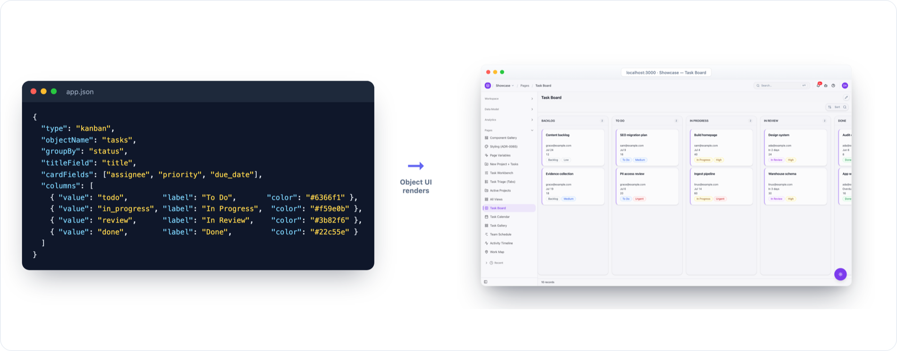
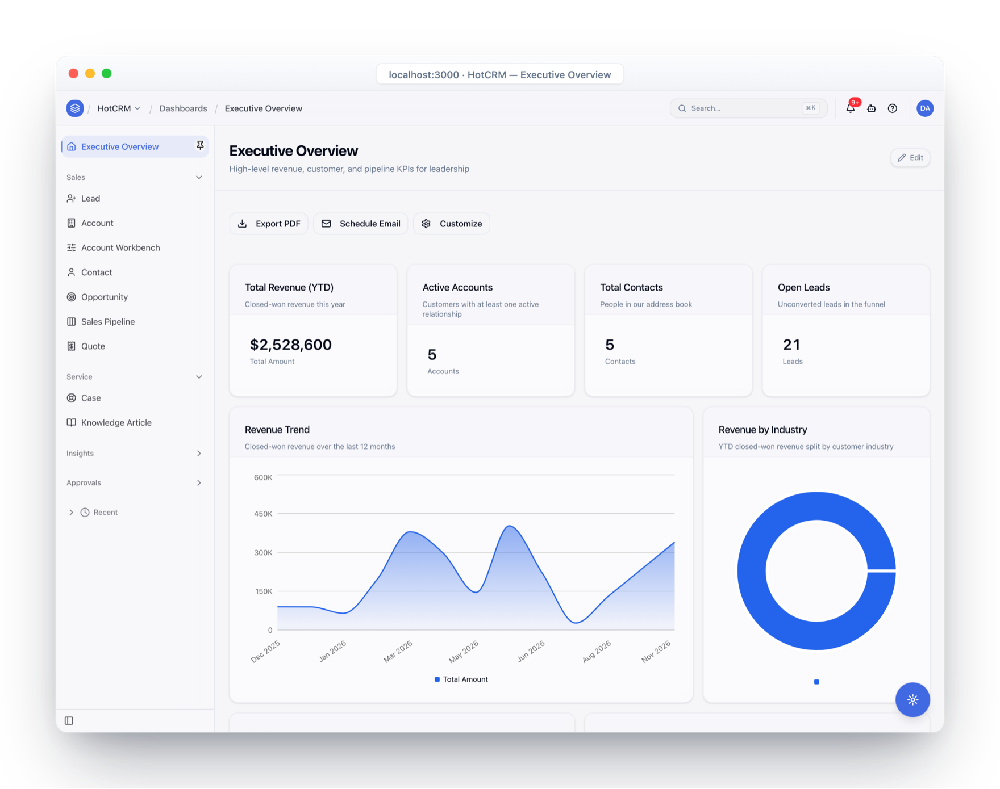
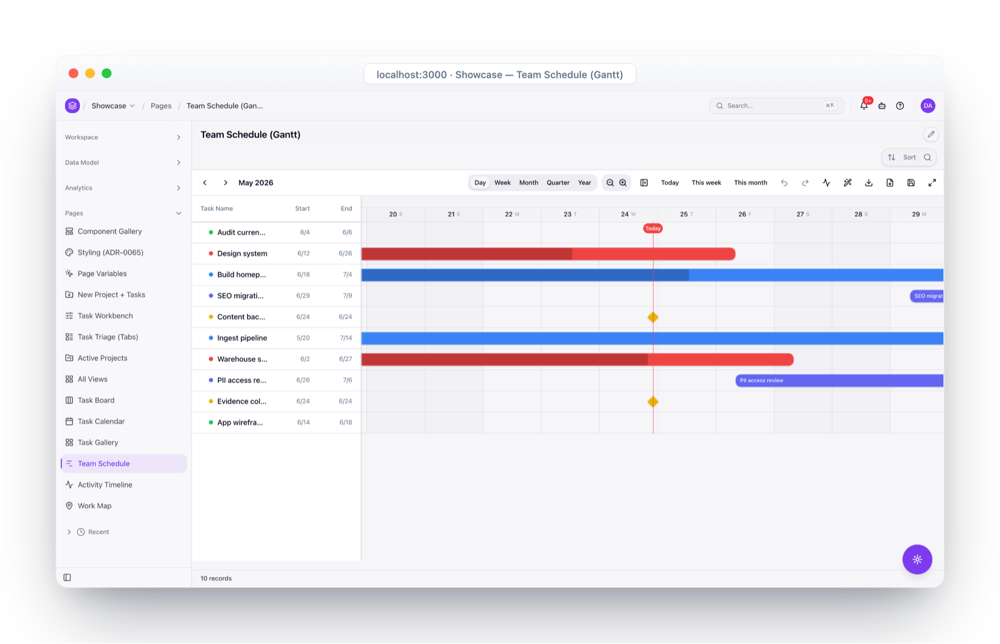
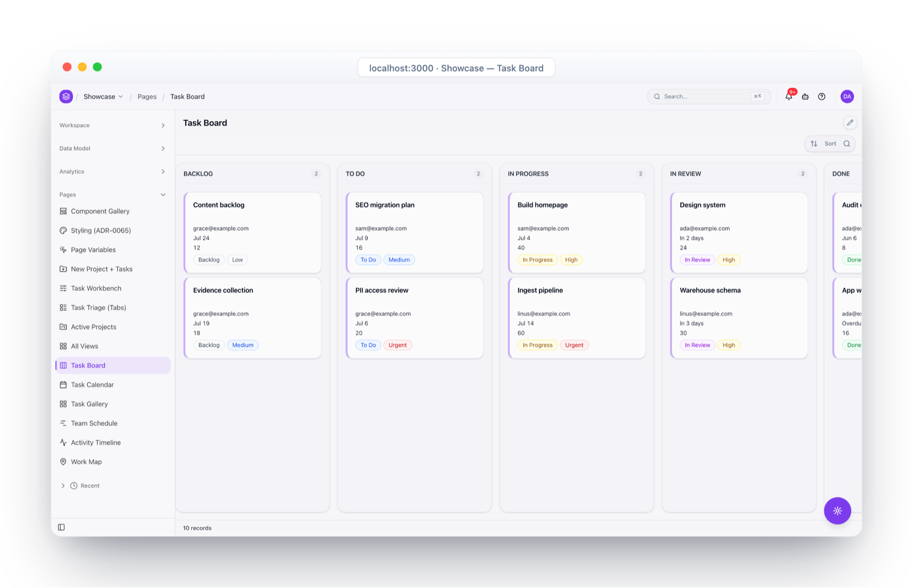
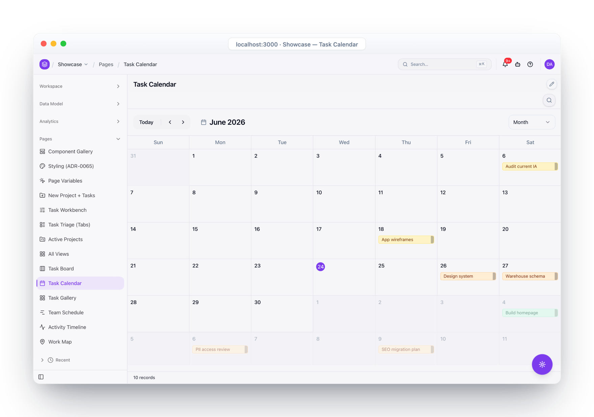
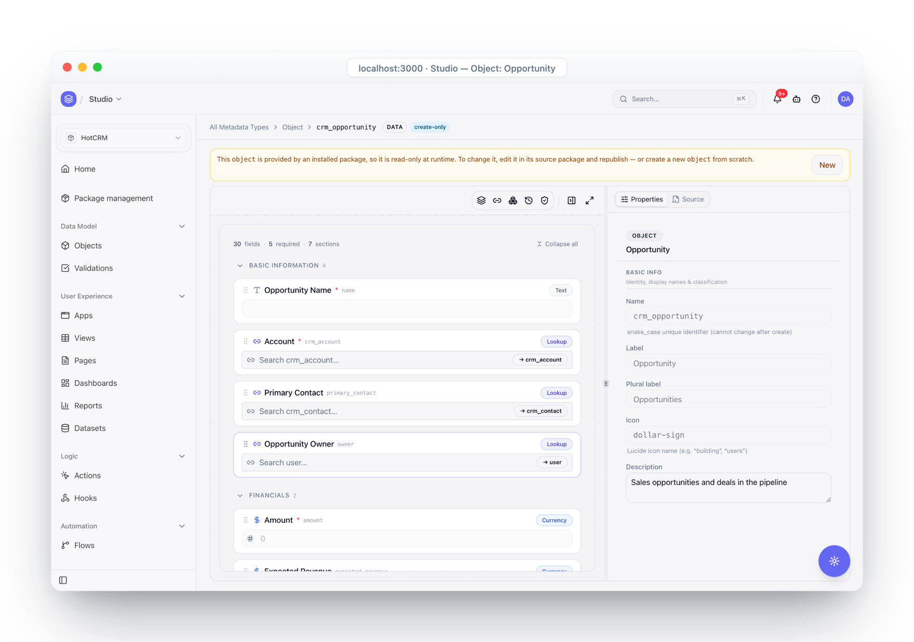
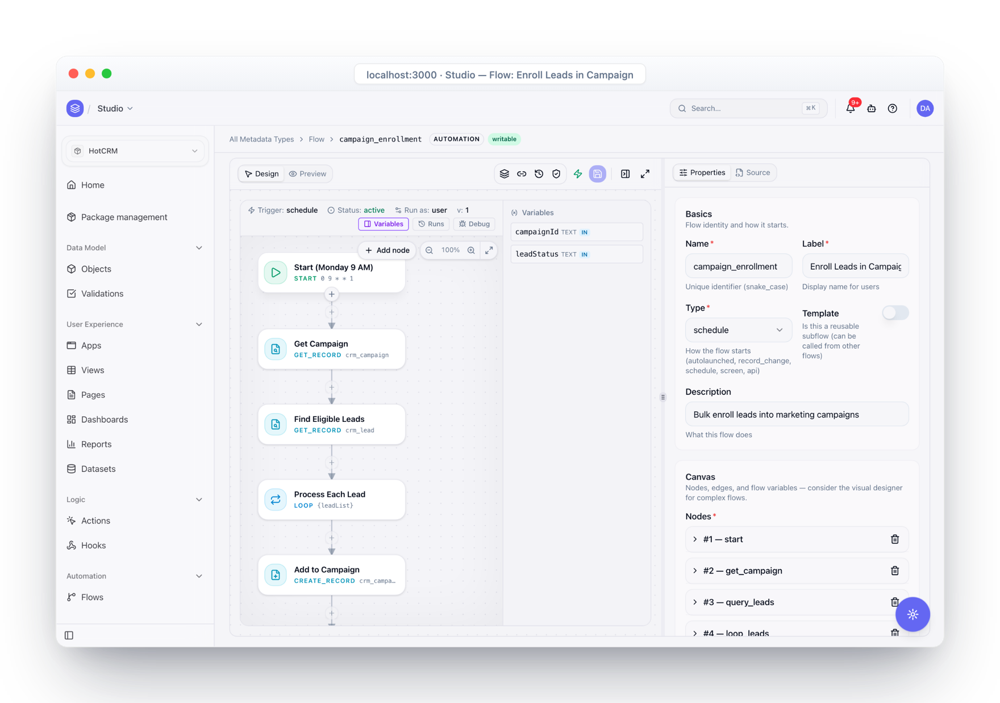

<div align="center">

# Object UI

**The Universal Schema-Driven UI Engine**

*AI writes the schema; Object UI renders it — production React, no component code*

[](LICENSE)
[](https://github.com/objectstack-ai/objectui/actions/workflows/ci.yml)
[](https://www.typescriptlang.org/)
[](https://react.dev/)
[](https://tailwindcss.com/)

[**Documentation**](https://www.objectui.org) | [**Quick Start**](#quick-start) | [**Examples**](./examples) | [**Changelog**](./CHANGELOG.md) | [**Roadmap**](./ROADMAP.md)

</div>

---

## What is Object UI?

**Object UI is the View layer of the [ObjectStack](https://github.com/objectstack-ai/objectstack) ecosystem** — a standalone, schema-driven renderer that turns a JSON schema (or ObjectStack metadata) into production-grade React UI. Use it on its own with any backend, like Amis or Formily — or let it render ObjectStack apps end to end. Schema-driven is also what makes UI **AI-writable**: an agent that would drown hand-writing React across fifty screens can emit and refactor compact schemas instead — and every screen stays consistent by construction.

```
Describe  →  ObjectStack   the open-source protocol, toolkit & production runtime
Render    →  Object UI     this repo — JSON / metadata → React UI
Operate   →  ObjectOS      the commercial runtime environment (Cloud & Enterprise)
```

<p align="center">
  
  <br><sub>A JSON schema in, a production React UI out — no component code.</sub>
</p>

One schema, many view types — dashboards, Gantt schedules, kanban boards, calendars — plus visual designers to build them without code.

<p align="center">
  
  
</p>
<p align="center">
  
  
</p>
<p align="center">
  
  
</p>
<p align="center"><sub><b>Dashboard, Gantt, Kanban, Calendar</b> rendered from metadata, plus <b>visual designers</b> for objects and flows — all from the plugin packages listed below.</sub></p>

## Quick Start

Pick the path that matches where you are starting from:

| You want to… | Start here | Install |
|---|---|---|
| Render a JSON schema inside your React app | [`examples/hello-world`](examples/hello-world) | `@object-ui/react @object-ui/components` |
| Embed views in an existing app, against **your own** backend | [`examples/byo-backend-console`](examples/byo-backend-console) | `@object-ui/app-shell @object-ui/plugin-view @object-ui/providers` |
| Stand up a complete console on an **ObjectStack** backend | [`examples/console-starter`](examples/console-starter) | fork the example |
| Build a UI from a JSON file, no React code at all | [`@object-ui/cli`](packages/cli) | `npm install -g @object-ui/cli` |

The [examples catalog](examples/README.md) explains each one in more depth.

### Render a schema

```bash
npm install @object-ui/react @object-ui/components
```

#### Basic Usage

```tsx
import React from 'react'
import { PredicateScopeProvider, SchemaRenderer } from '@object-ui/react'
import type { DeclaredNode } from '@object-ui/types'
// Importing the package registers every default renderer as a side effect —
// there is no separate registration call.
import '@object-ui/components'

const schema: DeclaredNode = {
  type: "page",
  title: "Dashboard",
  children: {
    type: "grid",
    columns: 3,
    children: [
      { type: "statistic", label: "Total Users", value: "${stats.users}" },
      { type: "statistic", label: "Revenue", value: "${stats.revenue}" },
      { type: "statistic", label: "Orders", value: "${stats.orders}" }
    ]
  }
}

function App() {
  // Every key of this object becomes a root the schema's expressions can read —
  // `stats` here is what answers `${stats.users}`.
  const scope = {
    stats: { users: 1234, revenue: "$56,789", orders: 432 }
  }

  return (
    <PredicateScopeProvider scope={scope}>
      <SchemaRenderer schema={schema} />
    </PredicateScopeProvider>
  )
}

export default App
```

Expression scope reaches the renderer through the provider, never through a prop on the
element. `SchemaRenderer` declares exactly one prop, `schema`, and forwards every other prop
it is handed to the component the schema names — so a value passed as `data={…}` is neither
read nor refused, and the expression that wanted it is returned as its own source text, with
nothing thrown and one line on the console.

### Bring your own backend

Use the shell and views without the full console infrastructure — your routing, your auth, your API:

```bash
npm install @object-ui/app-shell @object-ui/plugin-view @object-ui/providers
```

```tsx
import type { FC } from 'react';
import { AppShell } from '@object-ui/app-shell';
import { ObjectView } from '@object-ui/plugin-view';
import { ThemeProvider, DataSourceProvider, useDataSource } from '@object-ui/providers';
import type { DataSource } from '@object-ui/types';

// The two pieces you bring: the backend adapter you implement (see "Custom
// Data Sources" below) and your own sidebar component.
declare const myAPI: DataSource;
declare const MySidebar: FC;

function MyConsole() {
  return (
    <ThemeProvider>
      <DataSourceProvider dataSource={myAPI}>
        <AppShell sidebar={<MySidebar />}>
          <ContactList />
        </AppShell>
      </DataSourceProvider>
    </ThemeProvider>
  );
}

function ContactList() {
  const dataSource = useDataSource();
  return (
    <ObjectView schema={{ type: 'object-view', objectName: 'contact' }} dataSource={dataSource} />
  );
}
```

[`examples/byo-backend-console`](examples/byo-backend-console) is the complete working version, with a mock REST adapter.

### No React at all

```bash
npm install -g @object-ui/cli
objectui init my-app      # scaffold an app with a sample schema
cd my-app
objectui dev app.json     # dev server on http://localhost:3000
```

Edit `app.json` to build your UI.

### Run the examples from this repo

```bash
pnpm run setup      # builds @objectstack/* at .objectstack-sha, then installs
pnpm -w build

cd examples/console-starter   # or examples/byo-backend-console
pnpm dev
```

`hello-world` ships no dev server: copy its `App.tsx` and `schema.json` into your own
Vite/Next.js app. `schema-catalog` is a data package — the canonical JSON schemas the
docs render, a smoke test mounts, and AI agents use as a few-shot corpus.

## Copy-Paste Schemas

A `${name.…}` in any of these reads the root `name` off the scope the host published — see
["Basic Usage"](#basic-usage) for the provider that publishes one. A head name nothing
published is not an error: the expression is returned as its own source text.

#### 📝 Contact Form

```json
{
  "type": "form",
  "fields": [
    { "name": "name", "type": "text", "label": "Full Name", "required": true },
    { "name": "email", "type": "email", "label": "Email", "required": true },
    { "name": "subject", "type": "select", "label": "Subject", "options": [
      { "label": "General Inquiry", "value": "general" },
      { "label": "Bug Report", "value": "bug" },
      { "label": "Feature Request", "value": "feature" }
    ]},
    { "name": "message", "type": "textarea", "label": "Message", "required": true }
  ],
  "submitLabel": "Send Message"
}
```

#### 📊 Data Grid

```json
{
  "type": "object-grid",
  "properties": {
    "objectName": "user",
    "title": "Users",
    "columns": [
      { "field": "name", "label": "Name", "sortable": true },
      { "field": "email", "label": "Email" },
      { "field": "role", "label": "Role" },
      { "field": "status", "label": "Status" },
      { "field": "created_at", "label": "Joined" }
    ],
    "showSearch": true,
    "operations": { "create": true, "update": true, "delete": true, "export": true }
  }
}
```

#### 📈 Dashboard

A row of live KPI tiles. A `dashboard` node's `widgets[]` takes `metric-card` entries and
dataset-bound charts instead; see the [`@object-ui/plugin-dashboard` README](packages/plugin-dashboard/README.md).

```json
{
  "type": "grid",
  "columns": 4,
  "children": [
    { "type": "statistic", "label": "Revenue", "value": "${stats.revenue}", "trend": "up", "description": "+12%" },
    { "type": "statistic", "label": "Orders", "value": "${stats.orders}", "trend": "up", "description": "+8%" },
    { "type": "statistic", "label": "Customers", "value": "${stats.customers}", "trend": "up", "description": "+5%" },
    { "type": "statistic", "label": "Conversion", "value": "${stats.conversion}", "trend": "down", "description": "-2%" }
  ]
}
```

#### 🔄 Kanban Board

```json
{
  "type": "object-kanban",
  "objectName": "tasks",
  "groupBy": "status",
  "cardTitle": "title",
  "cardFields": ["assignee", "priority", "due_date"],
  "columns": [
    { "id": "todo", "title": "To Do", "className": "border-t-2 border-indigo-500" },
    { "id": "in_progress", "title": "In Progress", "className": "border-t-2 border-amber-500" },
    { "id": "review", "title": "In Review", "className": "border-t-2 border-blue-500" },
    { "id": "done", "title": "Done", "className": "border-t-2 border-green-500" }
  ]
}
```

> 📖 **More schemas:** [`examples/schema-catalog`](examples/schema-catalog) is the canonical catalog; [examples/](./examples/) has complete working applications.

## 🔌 Data Integration

Object UI talks to any backend through one `DataSource` interface.

### ObjectStack

```bash
npm install @object-ui/data-objectstack
```

```tsx
import { createObjectStackAdapter } from '@object-ui/data-objectstack';
import { SchemaRenderer, SchemaRendererProvider } from '@object-ui/react';
import type { DeclaredNode } from '@object-ui/types';

// Your page schema — "Render a schema" above writes one out in full.
declare const schema: DeclaredNode;

const dataSource = createObjectStackAdapter({
  baseUrl: 'https://api.example.com',
  token: 'your-auth-token'
});

// The adapter is injected through the provider — `SchemaRenderer` does not read
// a `dataSource` prop, it forwards it to the component the schema names.
<SchemaRendererProvider dataSource={dataSource}>
  <SchemaRenderer schema={schema} />
</SchemaRendererProvider>
```

⛔ `dataSource` is the **adapter** — the object data renderers call `find()` on — and not an
expression root. It is a different channel from the expression scope above: publish the values
your `${…}` expressions read with `PredicateScopeProvider`, and inject the adapter your data
components query with `SchemaRendererProvider`.

### Custom Data Sources

Adapt any backend (REST, GraphQL, Firebase, …) by implementing `DataSource`:

```typescript
import type { DataSource, QueryParams, QueryResult } from '@object-ui/types';

// The members `DataSource` REQUIRES — declared here without bodies, so the
// contract is complete instead of elided. Every other member of the interface
// is optional: implement the ones your backend supports.
declare class MyCustomDataSource<T = unknown> implements DataSource<T> {
  find(resource: string, params?: QueryParams): Promise<QueryResult<T>>;
  findOne(resource: string, id: string | number, params?: QueryParams): Promise<T | null>;
  create(resource: string, data: Partial<T>): Promise<T>;
  update(resource: string, id: string | number, data: Partial<T>, opts?: { ifMatch?: string }): Promise<T>;
  delete(resource: string, id: string | number, opts?: { ifMatch?: string }): Promise<boolean>;
  getObjectSchema(objectName: string): Promise<unknown>;
}
```

[**Data Source Examples →**](./packages/types/examples/rest-data-source.ts)

## Why Object UI?

**Stop writing repetitive UI code.** A form is a schema, not a component:

```tsx
import type { ObjectFormBlockNode } from '@object-ui/types';

// Traditional React: useState, validation, handlers, JSX — per form
function UserForm() {
  // ...
}

// Object UI: declare it — the block's props go in its `properties` bag,
// as `@objectstack/spec` declares them
const schema: ObjectFormBlockNode = {
  type: "object-form",
  properties: {
    objectName: "user",
    mode: "create",
    fields: ["name", "email", "role"]
  }
}
```

- **Shadcn-native.** Components follow Shadcn's DOM structure and Tailwind utilities, so every schema node accepts `className` overrides and dark mode just works.
- **Backend-agnostic.** One `DataSource` interface; adapters for ObjectStack, REST, or anything you write.
- **Full control.** Mix with existing React, override any component in the registry, lazy-load heavy plugins only where they render.
- **Typed protocol.** Every schema is a TypeScript type in `@object-ui/types`, derived from `@objectstack/spec`.

| | Object UI | Amis | Formily | Material-UI |
|---------|-----------|------|---------|-------------|
| **Tailwind native** | ✅ | ❌ | ❌ | ❌ |
| **TypeScript** | ✅ Full | Partial | ✅ Full | ✅ Full |
| **Tree shakable** | ✅ | ❌ | ⚠️ Partial | ⚠️ Partial |
| **Visual designer** | ✅ | ✅ | ❌ | ❌ |
| **Backend-agnostic data layer** | ✅ | ✅ | ⚠️ Forms only | ❌ |

## 📦 Packages

Grouped by dependency weight — atoms and fields stay light, heavy widgets live in plugins.

### Core

| Package | Description |
|---------|-------------|
| **[@object-ui/types](./packages/types)** | Pure TypeScript definitions — the protocol layer |
| **[@object-ui/core](./packages/core)** | Registry, validation, expression evaluation; zero React |
| **[@object-ui/react](./packages/react)** | React bindings and `SchemaRenderer` |
| **[@object-ui/components](./packages/components)** | Standard UI components (Tailwind + Shadcn) |
| **[@object-ui/fields](./packages/fields)** | Field renderers and registry |
| **[@object-ui/layout](./packages/layout)** | Layout components with React Router integration |

### Application shell

| Package | Description |
|---------|-------------|
| **[@object-ui/app-shell](./packages/app-shell)** | Minimal application shell — the base of every console |
| **[@object-ui/providers](./packages/providers)** | Theme, data-source, and other reusable context providers |
| **[@object-ui/auth](./packages/auth)** | `AuthProvider`, `useAuth`, `AuthGuard`, sign-in forms |
| **[@object-ui/permissions](./packages/permissions)** | Object / field / row-level permission guards and hooks |
| **[@object-ui/i18n](./packages/i18n)** | Language packs, RTL layout, date and currency formatting |
| **[@object-ui/mobile](./packages/mobile)** | Responsive components, PWA support, touch gestures |
| **[@object-ui/collaboration](./packages/collaboration)** | Presence, live cursors, conflict resolution, comment threads |
| **[@object-ui/console](./apps/console)** | Fork-ready runtime console with the full plugin set, shipped as a Hono plugin |

### Data adapters

| Package | Description |
|---------|-------------|
| **[@object-ui/data-objectstack](./packages/data-objectstack)** | ObjectStack data adapter |

### Plugins (lazy-loaded)

| Plugin | Description |
|--------|-------------|
| **[@object-ui/plugin-view](./packages/plugin-view)** | ObjectQL-integrated object views (grid, form, detail) |
| **[@object-ui/plugin-grid](./packages/plugin-grid)** | Advanced data grid |
| **[@object-ui/plugin-form](./packages/plugin-form)** | Advanced form components |
| **[@object-ui/plugin-detail](./packages/plugin-detail)** | Detail pages with sections, tabs, and related lists |
| **[@object-ui/plugin-list](./packages/plugin-list)** | Unified list view with view-type switching |
| **[@object-ui/plugin-kanban](./packages/plugin-kanban)** | Kanban boards with drag-and-drop (dnd-kit) |
| **[@object-ui/plugin-calendar](./packages/plugin-calendar)** | Calendar views |
| **[@object-ui/plugin-gantt](./packages/plugin-gantt)** | Gantt charts |
| **[@object-ui/plugin-timeline](./packages/plugin-timeline)** | Timelines |
| **[@object-ui/plugin-tree](./packages/plugin-tree)** | Tree and tree-grid views |
| **[@object-ui/plugin-map](./packages/plugin-map)** | Map visualization |
| **[@object-ui/plugin-charts](./packages/plugin-charts)** | Charts powered by Recharts |
| **[@object-ui/plugin-dashboard](./packages/plugin-dashboard)** | Dashboard layouts and widgets |
| **[@object-ui/plugin-report](./packages/plugin-report)** | Pivot tables, grouped aggregations, printable reports |
| **[@object-ui/plugin-designer](./packages/plugin-designer)** | Visual page, data-model, process, and report designers |
| **[@object-ui/plugin-editor](./packages/plugin-editor)** | Rich text editor powered by Monaco |
| **[@object-ui/plugin-markdown](./packages/plugin-markdown)** | Markdown rendering |
| **[@object-ui/plugin-chatbot](./packages/plugin-chatbot)** | Chatbot interface |
| **[@object-ui/plugin-ai](./packages/plugin-ai)** | Schema generation and conversational assistants (Vercel AI SDK) |

### Tooling

| Package | Description |
|---------|-------------|
| **[@object-ui/cli](./packages/cli)** | Scaffold, develop, build, and validate schema-driven apps |
| **[@object-ui/create-plugin](./packages/create-plugin)** | Scaffold a new Object UI plugin |
| **[@object-ui/runner](./packages/runner)** | Universal application runner for testing schemas |
| **[@object-ui/sdui-parser](./packages/sdui-parser)** | Constrained JSX source → schema tree compiler (parse, never execute) |
| **[@object-ui/react-runtime](./packages/react-runtime)** | Trusted runtime execution for `kind: 'react'` pages |
| **[vscode-extension](./packages/vscode-extension)** | IntelliSense and live preview for schema files |

## 🤝 Contributing

Contributions are welcome — read the [Contributing Guide](./CONTRIBUTING.md) first.

```bash
git clone https://github.com/objectstack-ai/objectui.git
cd objectui
./scripts/setup.sh    # or: pnpm run setup && pnpm build
pnpm dev              # development site
pnpm test
```

- 📖 [Quick Reference](./QUICK_REFERENCE.md) — the one-page command cheat-sheet for this monorepo
- 🧭 [AGENTS.md](./AGENTS.md) — the working rules, for humans and coding agents alike
- 🏗️ [Architecture Overview](https://www.objectui.org/docs/guide/architecture-overview) — package topology and boundaries
- 🔄 [@objectstack/spec](https://github.com/objectstack-ai/objectstack/tree/main/packages/spec) — the protocol this renderer implements
- 🗺️ [Roadmap](./ROADMAP.md) — current status and upcoming milestones

## 🌟 Community & Support

- ⭐ [Star on GitHub](https://github.com/objectstack-ai/objectui) — it helps others find the project
- 📖 [Documentation](https://www.objectui.org) — guides and API reference
- 🐛 [Report Issues](https://github.com/objectstack-ai/objectui/issues) — found a bug? Let us know
- 🧠 **Agent skill** — `npx skills add objectstack-ai/objectui` installs an Object UI skill for Claude Code, Cursor, Copilot, and more

## 📄 License

Object UI is [MIT licensed](./LICENSE). Object UI is inspired by and builds upon ideas from
[Amis](https://github.com/baidu/amis), [Formily](https://github.com/alibaba/formily),
[Shadcn/UI](https://ui.shadcn.com/), and [Tailwind CSS](https://tailwindcss.com/).

---

<div align="center">

**Built with ❤️ by the [ObjectStack team](https://github.com/objectstack-ai)**

[Website](https://www.objectui.org) · [Documentation](https://www.objectui.org) · [GitHub](https://github.com/objectstack-ai/objectui)

</div>
